<div align="center">
  
  <p>
    <a href="LICENSE"></a>
    <a href="https://github.com/asterisk-labs/geozl/actions/workflows/ci.yml"></a>
    
    <a href="https://pypi.org/project/geozl"></a>
    <a href="https://asterisk-labs.r-universe.dev/geozl"></a>
    <a href="bindings/julia/README.md"></a>
    <a href="https://www.npmjs.com/package/@asterisk-labs/geozl"></a>
    <a href="https://github.com/asterisk-labs/geozl/actions/workflows/platforms.yml"></a>
    <a href="https://github.com/facebook/openzl"></a>
  </p>
</div>

---

GeoZL extends [OpenZL](https://github.com/facebook/openzl) with codecs designed
for Earth observation data. It adds spatial prediction, NoData
handling, efficient integer packing and bounded-error quantization for
multidimensional numeric arrays. The same core is available from C, Python, R,
Julia and JavaScript.

## Bindings

| Language | Install | Role | Docs |
|----------|---------|------|------|
| Python | `pip install geozl` | full API and OpenZL nodes | [README](bindings/python/README.md) |
| R | `install.packages("geozl", repos = "https://asterisk-labs.r-universe.dev")` | graph, compress, decompress, profile | [README](bindings/r/README.md) |
| Julia | `Pkg.Registry.add(url="https://github.com/asterisk-labs/AsteriskRegistry"); Pkg.add("GeoZL")` | graph, compress, decompress, profile | [README](bindings/julia/README.md) |
| JavaScript | `npm install @asterisk-labs/geozl` | compress, decompress | [README](tools/wasm/README.md) |

| Platform | Python package | GPU decode |
|----------|----------------|------------|
| Linux x86-64 | wheel on PyPI | NVIDIA, through CUDA |
| macOS arm64 | wheel on PyPI | Apple GPUs, through Metal |
| Linux arm64, macOS x86-64, Windows x64 and arm64 | build from this repository | no |

Every platform decodes on the CPU, with SIMD where the CPU has it. GPU decode is
part of the C API in [`geozl/gpu.h`](core/include/geozl/gpu.h) and needs only the
NVIDIA driver or macOS, not the CUDA toolkit.
[Rumi](https://asterisk.coop/rumi/) uses it to read straight into PyTorch tensors.
The [platform matrix](https://github.com/asterisk-labs/geozl/actions/workflows/platforms.yml)
builds and tests the source builds.

## Quick start

```python
import numpy as np
import geozl

y, x = np.mgrid[0:1024, 0:1024]
tile = (2000 + 8 * y + 5 * x).astype(np.uint16)

best = geozl.profile(tile)[0]["graph"]        # rank recipes on a sample
g = geozl.graph(tile, best)                   # build once, reuse per tile
frame = geozl.compress(tile, graph=g)
back = geozl.decompress(frame).view(np.uint16).reshape(tile.shape)
```

## Codecs

GeoZL adds seventeen codecs to OpenZL, in four families.
[Predictors](https://asterisk.coop/geozl/predictors.html) turn samples into small
residuals, [stream codecs](https://asterisk.coop/geozl/streams.html) split and pack,
[fused codecs](https://asterisk.coop/geozl/fused.html) run a common chain in one pass,
and [quantizers](https://asterisk.coop/geozl/near-lossless.html) trade a bounded error
for smaller numbers. The [codec overview](https://asterisk.coop/geozl/docs.html#ctids)
lists every codec with its CTid, and each one's section gives its header and wire format.

## AI agent skill

Install the [GeoZL skill](https://github.com/asterisk-labs/geozl/blob/main/.claude/skills/geozl/SKILL.md) so coding agents know its graph recipes, bounded-error rules and codec internals.

```bash
npx skills add asterisk-labs/geozl
```

## Development

```bash
make submodules
make test       # C tests and pytest
make help       # R, Julia, wasm, sanitizers and fuzzing
```

## Acknowledgements

GeoZL is developed by [Asterisk Labs](https://asterisk.coop) as part of
[Earth Compress](https://asterisk.coop/project-pages/earth-compress.html), a
project led by Asterisk Labs and the
[National Oceanography Centre](https://noc.ac.uk/) and funded by
[ARIA](https://www.aria.org.uk/).

<p align="center">
  <a href="https://asterisk.coop"></a>
  &nbsp;&nbsp;&nbsp;&nbsp;
  <a href="https://asterisk.coop/project-pages/earth-compress.html"></a>
  &nbsp;&nbsp;&nbsp;&nbsp;
  <a href="https://noc.ac.uk/"></a>
  &nbsp;&nbsp;&nbsp;&nbsp;
  <a href="https://www.aria.org.uk/"></a>
</p>

## License

BSD-3-Clause.
